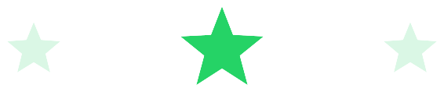
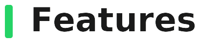

<picture>
  <source media="(prefers-color-scheme: dark)" srcset="./assets/brand/title_dark.png">
  <source media="(prefers-color-scheme: light)" srcset="./assets/brand/title_light.png">
  
</picture>

 

<picture>
  <source media="(prefers-color-scheme: dark)" srcset="./assets/brand/stars_dark.png">
  <source media="(prefers-color-scheme: light)" srcset="./assets/brand/stars_light.png">
  
</picture>

 
 

  
  &nbsp;
  
  &nbsp;
  
  &nbsp;
  

  <b>WaModX</b> is an <b>unofficial WhatsApp mod</b> shipped as a <b>standalone APK</b>
  built against hand-written stubs — never against WhatsApp's real classes.
   
  A separate smali patchset in
  <a href="https://github.com/SoughtXp/whatsapp-apktool"><code>whatsapp-apktool</code></a>
  rewires the host APK to call into these hooks.

<b>End-to-end loop</b>

  
  →
  
  →
  
  →
  
  →
  
   
  
  →
  
  →
  
  →
  
  →
  

<picture>
  <source media="(prefers-color-scheme: dark)" srcset="./assets/headings/features_dark.png">
  <source media="(prefers-color-scheme: light)" srcset="./assets/headings/features_light.png">
  
</picture>

 

 <b>Anti Revoke Status</b> 
 <b>Anti Revoke Messages</b> 
 <b>Freeze Last Seen</b> 
 <b>Hide Status View</b> 
 <b>Hide Blue Ticks</b> 
 <b>Blue Ticks After Reply</b> 
 <b>Hide Typing / Recording Audio</b> 
 <b>Anti View Once</b> 
 <b>Download Status / Copy Status Text</b> 
 <b>Bypass Anti Ban</b> 
 <b>Fix SMS</b> 
 <b>Design Mods</b>

 

<picture>
  <source media="(prefers-color-scheme: dark)" srcset="./assets/headings/map_dark.png">
  <source media="(prefers-color-scheme: light)" srcset="./assets/headings/map_light.png">
  
</picture>

 

Every WhatsApp release reshuffles the obfuscated class names like `LX/1Ex`,
which is why the two repos always move together: refresh the decompile
first, then re-check the stubs against it.

 the target release 
 apktool output, where the real names live 
 one per class, <code>compileOnly</code>, never shipped 
 built against the stubs above

 

<picture>
  <source media="(prefers-color-scheme: dark)" srcset="./assets/headings/contributing_dark.png">
  <source media="(prefers-color-scheme: light)" srcset="./assets/headings/contributing_light.png">
  
</picture>

 

The most useful PR you can send is a stub that stopped matching after a
WhatsApp update. One concern per PR keeps it reviewable, and easy to
revert on its own if it turns out to be wrong.

 your own copy
 
 one per change 
 one concern per commit 
 to your fork 
 against <code>main</code>

 

<picture>
  <source media="(prefers-color-scheme: dark)" srcset="./assets/headings/license_dark.png">
  <source media="(prefers-color-scheme: light)" srcset="./assets/headings/license_light.png">
  
</picture>

Released under the <a href="./LICENSE"><b>MIT License</b></a>.

